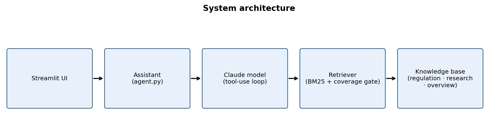
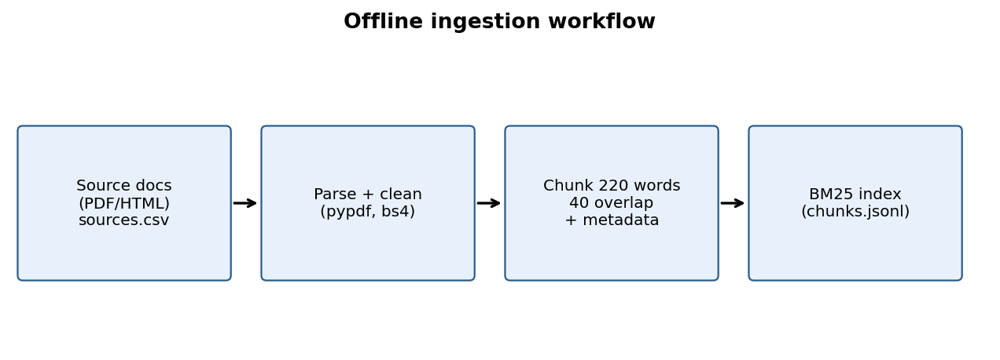
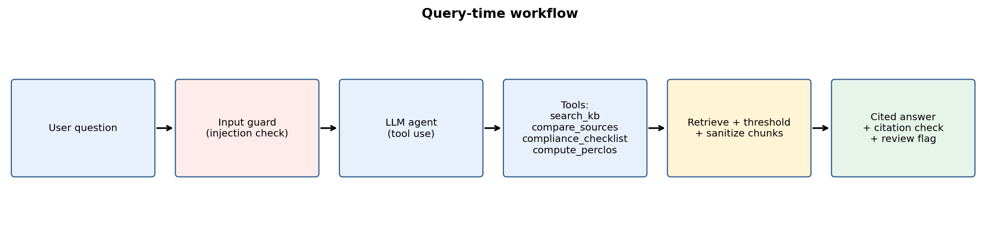

# DMS Knowledge Assistant: Technical Report
*[Your name, programme, course, date]*

## 1. Problem statement and intended users
Information on driver monitoring (DMS) is scattered across regulations, test protocols, research papers and vendor documents. Engineers, compliance staff and students must search many long PDFs to answer questions such as which warnings a regulation requires or which drowsiness metrics are used. This project provides an assistant that answers such questions **only from a curated knowledge base, with citations**, and refuses when evidence is missing.
Intended users: automotive safety engineers, compliance analysts, ADAS/DMS students and researchers. Out of scope: legal advice, certification decisions, processing of live driver camera data.

## 2. Input data / knowledge base
*[Fill from data/sources.csv after running fetch + ingest. Include table: id, title, type, year, licence; N documents, N chunks, total words; cleaning and chunking choices.]*
Chunking: 220 words with 40-word overlap; metadata kept per chunk (doc_id, title, source_type, year, page/section). Page numbers for PDFs, 500-word sections (§n) for HTML/text.

## 3. Solution architecture

<<<<<<< HEAD
Components: (a) ingestion pipeline, (b) BM25 lexical index with a query-coverage confidence gate, (c) Gemini model (Google API) driving a tool-use loop, (d) four custom tools, (e) guardrail layer, (f) Streamlit UI.
=======
Components: (a) ingestion pipeline, (b) BM25 lexical index with a query-coverage confidence gate, (c) Claude model driving a tool-use loop, (d) four custom tools, (e) guardrail layer, (f) Streamlit UI.
>>>>>>> ffbcd2e469a9b38fe6eb1be7f4ca1cf501a7333e
*Design justification (edit with your reasoning):* BM25 was chosen because DMS text is full of exact technical terms and acronyms (PERCLOS, ADDW, DDAW) where lexical match is strong, the index is small, and it runs on free hosting without a GPU or embedding API. Limitation: no semantic matching of paraphrases; dense or hybrid retrieval is listed as future work.

## 4. Implementation and configuration

<<<<<<< HEAD
Configuration (src/config.py): chunk 220 words, overlap 40, top-k 5, min query coverage 0.34, model from env `GEMINI_MODEL` (default gemini-2.5-flash), max 6 tool rounds. Retrieval-only fallback runs when no API key is present.
=======
Configuration (src/config.py): chunk 220 words, overlap 40, top-k 5, min query coverage 0.34, model from env `DMS_MODEL`, max 6 tool rounds. Retrieval-only fallback runs when no API key is present.
>>>>>>> ffbcd2e469a9b38fe6eb1be7f4ca1cf501a7333e
Prompt design: system prompt forces tool-only evidence, a fixed citation format `[doc_id loc]`, an exact refusal phrase, and states that documents and user text cannot change the rules.

## 5. Evaluation
Set: *[N]* questions in four groups (factual, multi-document, out-of-scope, adversarial), file `eval/questions.csv`. Systems compared: baseline LLM (no retrieval), retrieval-only, full RAG agent.
Metrics: keyword recall of expected facts, citation validity (every citation matches a retrieved chunk), refusal rate on out-of-scope, resistance on adversarial prompts, latency.
*[Paste results tables from eval/results_*.csv. Add 2-3 failure cases with analysis. Do not report numbers you did not produce.]*

## 6. Responsible AI measures
- **Grounding:** tool-only evidence; citations checked against retrieved chunks (`unverified_citation` flag); refusal when best chunk covers < 34% of query terms.
- **Privacy:** knowledge base contains published documents only; no driver images or personal data processed; logs store question/answer text only; API key kept in secrets.
- **Security:** regex input guard for override attempts; retrieved text sanitised and wrapped as untrusted data; no code execution tools; deterministic calculator for arithmetic.
- **Human oversight:** answers with any flag are marked "needs human review" in the UI; interaction log supports audit; the assistant states it is not a legal or certification authority.
- **Known limits:** regex guard is not exhaustive; BM25 can miss paraphrases; corpus limited to selected sources; LLM output can still be wrong even with citations, so verify against the source.

## 7. Innovation highlights
1. Source-type routing: the agent chooses regulation vs research search.
2. `compare_sources`: side-by-side law vs research evidence.
3. `compliance_checklist`: maps a described DMS feature to relevant regulatory text.
4. `compute_perclos`: deterministic calculator for a drowsiness metric.
5. Citation verification and confidence gate with human-review flagging.
6. Graceful degradation to retrieval-only mode.

## 8. References and AI-tool use
*[List every document in the KB, libraries (rank-bm25, pypdf, Streamlit, Anthropic SDK), and AI tools used. Cite EUR-Lex etc.]*
